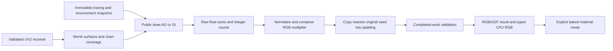

# Integrated draw lightmaps

The experimental `bg2e::bake` path uses an initialized draw Engine and public
Device-backed passes. Production `bg2e::render` editors and standalone tools
remain documented in the [production lightmap family](lightmaps/index.md).
The delivered windowed product is [draw_lightmaps](../apps/draw_lightmaps.md).

## Data and execution

UV2 means `geo::Vertex::texCoord1`, selected by UV index 1. Generate and validate
an independent atlas per receiver, retaining submesh material associations and
UV1. At a stopped boundary, [safe reload](../api/bake/UvSurfacePass.md) stages a
replacement drawable before publication. Rebind scene, tracing, selection and
preview consumers after replacement; pointer ownership alone does not invalidate
cached scene contents.

The Device-backed UvSurfacePass rasterizes UV triangles into signed world-space
position/normal plus integer submesh/chart maps, then computes coverage. It has
no camera or depth attachment. Chart membership comes from source-index edge
connectivity within each submesh; duplicated seam vertices remain isolated.
This is distinct from the CPU UvMapPreviewRenderer, which paints a diagnostic
RGBA8 image and uploads it for UI display.

[IntegratedBakerContext](../api/bake/IntegratedBakerContext.md) allows one live
baker and one open bake frame. The caller prepares, records, submits and confirms
GPU completion before completeFrame commits a sample. Recording alone advances
no progress. Serial numbers, source generations, target generations and completed
sample indices are separate identities. Cancelled/stale work cannot publish.
Submitted work must complete; abandonFrame is reserved for discarded unsubmitted
commands. Reset freezes the live settings again at a stopped boundary.

The example submits one sample synchronously before window acquisition. This
keeps completion explicit and input available between samples, but a costly
sample blocks input until it finishes. It captures all receiver results before
changing materials, so adoption does not mutate a later target's frozen source.
Device/Engine outlive contexts, retained results and preview registrations.

## Signal and precision boundaries

| Stage | Representation and meaning |
|---|---|
| Raw effect | R16 AO visibility or RGBA16 GI incoming radiance/pi with validity alpha. Required RT/profile failures are job failures. |
| Accumulation | RGBA32F raw sums and R32_UINT valid-update counts; equal frozen rays/update, no display EMA, denoise or reconstruction history. |
| Composition | AO mean, or GI mean divided channelwise by environment irradiance/pi. Zero reference gives zero. No receiver albedo or repeated PI. |
| Padding/result | RGBA32F multiplier; original interiors unchanged, padding copies one nearest original seed, outside radius neutral white. RGB and alpha are not coverage. |
| CPU pixels | Tight top-row-first linear RGB32F or RGB8; only byte GI applies exposure before clamp/round. No gamma or file encoding. |
| Display | RGBA16F G-buffer bakedMultiplier; consumer must reject nonfinite, negative or above-65504 values rather than silently clip. |

Final validation rejects empty coverage, missing/invalid covered updates, overflow
and raw GI saturation at or above 65504. It reads back synchronously and can drain
other Device submissions. Full-float composition/CPU results can exceed half-float
display range. [LightmapOutput](../api/bake/LightmapOutput.md) defines the exact
normalization, tie-breaking and conversion rules.

## Materials, previews and extension points

[IndirectTextureMode](../api/draw/BakedIndirectMaps.md) marks the existing AO slot
as scalar AO, baked RGB AO or baked RGB GI. Marked maps require opaque linear UV2
materials; update stored metadata and live GPU material slots. GI replaces diffuse
indirect lighting while preserving specular IBL/reflections, direct light and
emission. Baked AO modulates indirect IBL. Live AO/GI are bypassed per marked
pixel; disabling the unused passes also avoids their cost. One material cannot
carry both a separate authored scalar AO texture and a baked map in this slot.

[BakeLightmapPreview](../api/bake/BakeLightmapPreview.md) retains image/sampler
owners through the draw UI session. Rebind replacement images after restart or
resolution changes; clear registrations before UI/Engine teardown. A UV diagnostic
and a completed multiplier are separate views, both linear diagnostic data.

Public UV surface, AO/GI, accumulator and composition owners are injectable with
compatible interfaces. Mutable pass instances belong exclusively to one bake
lifecycle. The current denoise profile lacks chart isolation and is rejected.
See [raw executor](../api/bake/LightmapBakeExecutor.md) and the
[construction tutorial](../tutorials/draw/12_lightmaps.md) for actual APIs.
Both draw and bake paired native shader trees must be
[deployed](../api/gpu/ShaderLibraries.md#engine-paired-drawbake-deployment).

GPU ownership and serialized mode metadata do not create image/model files.
Standalone/batch baking and draw editor integration remain separate.
[Windowless camera export](draw_offscreen_rendering.md) is implemented through
OffscreenApplication and an independent linear camera-frame accumulator; it does
not use the UV-space bake counts/coverage in this integrated product. Runtime
numeric/performance verification remains project-lead-owned; documentation and
source checks do not establish Vulkan/Metal numerical equivalence.

The separate [standalone UV architecture](draw_standalone_lightmaps.md) and
[CLI](../apps/draw_lightmap_generator.md) are now delivered. They reuse raw bake
primitives with their own serial completion/source and whole-batch publication
lifecycle; the integrated example/adoption path remains independently scoped.
