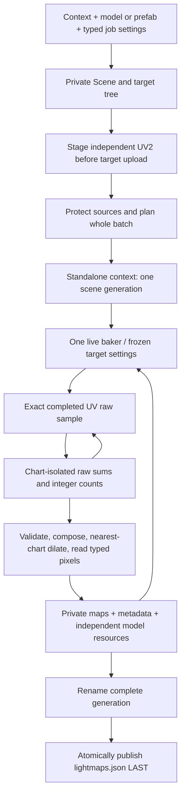

# Standalone UV bake ownership and publication

The experimental draw/bake standalone product borrows a windowless draw Engine,
reuses public tracing/UV/accumulation/composition primitives and publishes a whole
batch through one final manifest. Production render remains available separately.
The [tutorial](../tutorials/draw/standalone_lightmaps.md) and
[CLI guide](../apps/draw_lightmap_generator.md) use these actual owners.

The loops represent serial samples/targets; only the requested completed count
can reach final composition and only a complete staged batch can commit. There
is no camera RendererDeferred/history loop or per-target source-map adoption.

## Owner and validity boundaries

OffscreenApplication owns Engine/Device/context-surface lifetime in the CLI.
Its typed delegate requests no camera frames and performs batch work at finish.
Assembly retains Scene and complete root/container; context retains prepared
scene/environment/native owners; one baker owns target-specific executor/history/
output. Result paths and typed CPU pixels are host values. Every native owner must
release before Engine cleanup, even when wrapper objects survive cancellation.

Scene, target, device, recording and resource identity remain distinct. Reset
freezes target settings only within a current scene generation; source edits
require invalidation/repreparation and new jobs. The batch compares source files,
graph/component references, CPU/uploaded geometry, material/native revisions and
environment state around CPU callbacks and before publication. Arbitrary custom
state/GPU writes must remain stopped or be represented by job validity; no
signature makes unsynchronized producers safe.

Fresh logical snapshots may share indexed immutable material/shadow tables and
exactly matching completed acceleration. Existing completion-aware pools may
reuse unleased allocations without sharing mutable output identity. Editable
materials remain independent; no value-merging/global editable material catalog
or ResourceManager is introduced. Current tracing v3/shadow v5 ABI, device-clamped
capacity and warning/neutral texture overflow policy survive. Required unsupported
bake kernels/formats/RT still fail instead of becoming a neutral success.

Standalone synchronous work/clone/readback cleanup may drain to establish safe
ownership. This is separate from async CPU/GPU profiling; it does not weaken the
renderer's narrow typed final-color update path, lazy temporal signatures or
conservative transparent regions. No new timing wait or claimed throughput gain
follows from sharing/caches in source.

## Pixel, material and file boundaries

Raw sample validity and exact counts/chart masks precede normalized linear RGB
indirect multipliers. Alpha one is not coverage. CPU RGB32F preserves finite
nonnegative HDR; RGB8 applies GI exposure once then clamps/rounds. Raw native GI
precision can reject saturation independently of final RGBA32F encoding. Padding
copies a nearest original chart texel; it is not evidence of extra valid samples.

The AO texture slot can explicitly carry linear RGB bakedAO/bakedGI with UV2,
unit scale and channel zero. A retained sampled map is enough for integrated
material adoption but is not persisted output. The standalone writer clones
independent resources, attaches actual pixels and checks complete DB save's
bool-noexcept result before staging a target success. A single-model export is
not a full placed prefab scene. Generic DB image/archive/file APIs perform useful
IO; they do not own protected whole-batch policy.

Manifest publication is the batch's commit point. Each generation is unique and
previous complete generations remain valid through overwrite/cancel/error.
Readers resolve manifest-relative artifacts, not an in-progress directory listing.
The cooperative lock/stage protocol does not provide crash lock recovery, garbage
collection, simultaneous multi-file visibility, hostile-process protection or
power-loss durability. Final rename failure can leave an unreferenced complete
generation; cleanup failure after commit can report a runtime error with valid
output already present.

## Independent verification scope

A successful CLI exit alone does not prove map correctness. Independent file
decode checks extent/type/HDR/orientation and model material sidecars; native
model geometry reload, controlled lighting/chart edges, original source hashes,
interrupt/fault injection and actual installed shader roots are separate checks.
Synthetic inspector fixtures establish inspector behavior, not GPU performance
or Vulkan/Metal product execution. Keep lead continuation acceptance separate
from unspecified backend/scenario detail.

Sources: [context](../../lib/src/bg2e/bake/StandaloneBakerContext.cpp),
[assembly](../../lib/src/bg2e/bake/StandaloneBakeSceneAssembler.cpp),
[batch](../../lib/src/bg2e/bake/StandaloneBakeBatch.cpp),
[writer](../../lib/src/bg2e/bake/LightmapOutputWriter.cpp),
[DB complete snapshot](../../lib/src/bg2e/db/draw_resource_io.cpp).
