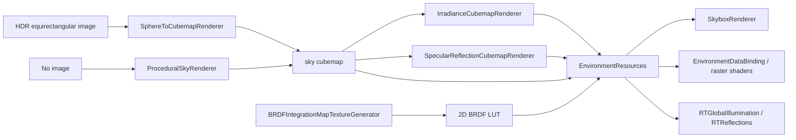

# Environment and IBL generation in `bg2e::draw`

This document describes the `bg2e::draw` implementation from selecting an HDR image or the procedural sky through GPU resource creation and consumption by the skybox, image-based lighting (IBL), and ray-tracing effects. The concrete implementations live in `lib/src/bg2e/draw/environment/`, their public interfaces in `lib/include/bg2e/draw/environment/`, and the shaders in `shaders/src/draw/environment/`.

## 1. Generator outputs

A complete generation publishes one `EnvironmentResources` object, an immutable shared snapshot for its consumers. It contains four linear HDR images:

| Resource | Type | Content and consumer |
| --- | --- | --- |
| `sky` | Cubemap with a mip chain | Environment radiance. It is drawn as the skybox and can be sampled as an environment signal. |
| `irradiance` | Cubemap, one mip | Diffuse environment integral convolved over the hemisphere. Used by ambient IBL and as an ambient input in some ray-tracing passes. |
| `prefilteredSpecular` | Cubemap with multiple mips | Environment convolved for several GGX roughness levels. Combined with the BRDF LUT for specular IBL and the blurred skybox. |
| `brdf` | 2D image, one mip | Split-sum BRDF integration LUT in RG, indexed by `N·V` and roughness. |

The snapshot also contains `sampler` for the three cubemaps, `brdfSampler` for the 2D LUT, and the skybox presentation settings `skyboxBlur` and `skyboxVisible`. The `shared_ptr`s keep images and samplers alive while consumers use them; the `Engine`/`Device` must outlive those consumers.

The high-level flow is:

The four stages run synchronously when generation or synchronization is requested. They are not part of each normal frame. Resynchronization happens at a controlled renderer boundary.

## 2. Public API and responsibilities

### `EnvironmentGenerator`

Declared in `EnvironmentGenerator.hpp` and implemented in `EnvironmentGenerator.cpp`, this is the public facade that coordinates resource lifecycle and assembly:

- `EnvironmentGenerator(Engine&, shaderRoot)` creates the default tools: equirectangular conversion, procedural sky, irradiance, specular prefilter, and BRDF LUT.
- `configuration()` returns `EnvironmentGenerationConfiguration&`, allowing individual `sphere`, `defaultSky`, `irradiance`, `specular`, and `brdf` tools to be replaced. Each tool retains its `GenerationSettings`.
- `build(path)` loads a source from disk. An empty path selects the procedural sky.
- `build(shared_ptr<gpu::Image>)` accepts a linear HDR equirectangular image already resident on the GPU.
- `requestRebuild()` marks that resources should be rebuilt at the next safe synchronization point.
- `synchronize(EnvironmentComponent*)` compares the image path, procedural sky colors, explicit rebuild request, and skybox options with the current state. It returns whether state or published resources changed.
- `resources()` returns the last snapshot as `shared_ptr<const EnvironmentResources>`.
- `cleanup()` waits for the device, cleans up the tools, and discards the snapshot.

The generator validates that the selected stages implement the expected semantic contracts (`draw.environment.sky.v1`, `irradiance.v1`, `prefilteredSpecular.v1`, and `brdf.v1`). Before publishing the result, it validates that images, formats, mip levels, read layouts, and samplers belong to the same `Device`. Each generation is assembled in a temporary variable named `next`; `_resources` is replaced only after generation and validation succeed. If a stage fails, consumers keep using the previously published snapshot.

Generation and cleanup call `Device::waitIdle()`. The documented contract requires stopping producers and coordinating resource changes during these operations; this is not an API to call concurrently from arbitrary threads.

### `EnvironmentGenerationConfiguration`

This lets callers replace each stage without rewriting the orchestrator. Replacing a tool does not remove contract constraints: a tool must provide the expected semantic interface and its outputs must meet the resource requirements of downstream stages.

### `GenerationSettings` and `CubemapRenderer`

`CubemapRenderer` implements `EnvironmentPass`, which extends `pipeline::RenderLayer`. It serves as a base for the concrete tools and as a render-layer contract for standalone generation stages. Its key API includes:

- `settings()` exposes the requested configuration; `initialize()` takes an internal copy (`_realized`) for the active generation.
- `setSource()` sets a GPU image source; it can only be called before initialization.
- `generate(Engine&, source)` creates/configures the output, submits commands, and returns the image.
- `contract()` describes the stage semantics and output.
- `record(PassContext)` records generation in a compatible context; outputs are owned by the stage.
- `resources()`, `image()`, and `cleanup()` expose output/resources and lifecycle operations.

`GenerationSettings` includes `size` (256 by default), `mipLevels` (1; `0` requests a full chain), `samples` (256, limited to 4096), linear HDR format (`R16G16B16A16_SFLOAT` by default, or `R32G32B32A32_SFLOAT`), `shaderRoot`, `vertexShader`, and `fragmentShader`. An empty fragment shader name selects the shader associated with the `GenerationKind`. The procedural sky adds the linear RGB colors `skyHorizonColor`, `skyZenithColor`, and `groundColor`; their defaults are `(0.55, 0.65, 0.8)`, `(0.06, 0.22, 0.6)`, and `(0.04, 0.035, 0.025)`. Components must be finite and in `[0,1]`; alpha is ignored.

The default tools adjust some values: sky and specular use a complete mip chain; irradiance uses size 32 and one mip; the BRDF LUT uses size 128 and one mip. The default size for sky and image conversion is 256. Specular requires at least two mips; irradiance and BRDF require exactly one. The full-chain mip count is calculated with `gpu::mipLevelsForMinSize`.

Concrete classes:

- `SphereToCubemapRenderer`: samples the equirectangular image for each cubemap face.
- `ProceduralSkyRenderer`: draws the sky directly into a cubemap and needs no source image.
- `IrradianceCubemapRenderer`: integrates radiance from the source cubemap.
- `SpecularReflectionCubemapRenderer`: produces a different GGX convolution for each mip.
- `BRDFIntegrationMapTextureGenerator`: integrates the BRDF response into a 2D texture.

### `EnvironmentResources`, `EnvironmentPass`, and `SkyboxPass`

`EnvironmentResources` is the shared, validated resource bundle. `EnvironmentPass` defines the `resources()` output interface for environment passes. `SkyboxPass` defines `setCamera(view, projection)` and `setEnvironment(snapshot)` for the skybox layer independently of its implementation.

## 3. Input: HDR file, GPU image, or procedural sky

Given a non-empty path, `EnvironmentGenerator::build(path)`:

1. Normalizes the path and calls `db::loadImage()`.
2. Requires floating-point pixel data and positive dimensions. It scans RGB channels and rejects non-finite values.
3. Computes the maximum absolute RGB value. It selects float16 unless `maxAbsRGB * PI > 65000`, in which case it promotes the source to float32 to leave headroom for the PI factor in irradiance convolution.
4. Queries `Device::formatCapabilities()` and requires support for sampling and transfers.
5. Creates a linear 2D `gpu::Image`, uploads it through `Image::uploadImage()`, and generates mipmaps with `Image::generateMipmaps()`.
6. Runs the equirectangular-to-cubemap, irradiance, specular, and BRDF stages.

An explicit GPU source must be non-null, valid, belong to the same `Device`, be sampleable, use a linear HDR format, and be in `ShaderReadOnly`; it must be a 2D equirectangular image. This API does not interpret an sRGB display image as radiometric environment input.

With an empty path, no source image is created: the generator selects `defaultSky`, which is `ProceduralSkyRenderer` by default. The synthetic sky is converted into the same `sky` cubemap type produced by image conversion and feeds the same downstream stages. Sky colors do not change the generation path when an HDR is selected, though the component configuration is retained for when the procedural sky is selected again.

## 4. Equirectangular conversion and procedural sky

`CubemapRenderer::recordGeneration()` executes a full-screen triangle for each cubemap face and mip. `gpu::CubemapRenderPass::render()` manages each face/mip target and provides a `gpu::CubemapFace`. The GLSL/Metal helper `cubeDirection(face, uv)` converts face coordinates into a normalized direction. The image-conversion stage maps that direction to equirectangular coordinates:

- `u = atan(z,x)/(2π) + 0.5`
- `v = acos(clamp(y,-1,1))/π`

It samples the HDR image using an LOD calculated from source and destination sizes, clamped to the last available mip. The horizontal coordinate repeats to close the longitude seam; the vertical coordinate clamps to the edges.

The `procedural_sky.frag.glsl` / `procedural_sky.frag.metal` shader evaluates each cubemap direction without sampling a source image. It uses `max(n.y,0)` to interpolate from horizon color to zenith color with `sqrt(altitude)`, creates the ground color, and applies a `smoothstep(-0.03, 0.03, n.y)` transition around the horizon. It adds a fixed sun in the direction `normalize((0.4,0.7,0.2))`, with RGB radiance `(8.0,6.5,4.0)` and exponent 512. The shader colors are configurable parameters; the sun direction, intensity, color, and size, along with the curve/transition, remain fixed in code.

Both shaders use the same `GenerationPush` push-constant structure populated by `CubemapRenderer`. It contains face, destination size, sample count, source size, roughness/LOD, maximum source LOD, and the three colors. The structure is aligned with the shared GLSL and Metal declarations; colors are passed as `vec4`/`float4`, and only `.rgb` is read.

## 5. Diffuse irradiance map

`IrradianceCubemapRenderer` receives the `sky` cubemap and creates a 32×32 output cubemap with one mip. For each texel, its shader calculates the normal/direction `n`, generates `samples` cosine-distributed hemisphere points around `n`, transforms those vectors into world space with `tangentToWorld()`, and accumulates radiance from `sky` using `textureLod()`.

The deterministic sequences use `hammersley(i, count)` and bit reversal; the sample LOD is chosen from texel area, source dimension, and sample count to reduce aliasing. The output is `sum * (PI / samples)`: stored irradiance includes the PI factor. The shading code therefore divides by PI when composing the material's diffuse contribution; this map is not irradiance already normalized by PI.

The irradiance cubemap has a single mip and is sampled with the linear environment sampler when supported by the format/device. No additional mip chain is generated for this resource.

## 6. Specular IBL reflections

`SpecularReflectionCubemapRenderer` creates the `prefilteredSpecular` cubemap with a full mip chain. Mip `m` represents roughness `m / (mipLevels - 1)` (a scale from 0 to 1). For near-zero roughness, the shader copies the LOD-zero sample. For other mips:

1. Generates GGX microfacet normals `h` from a Hammersley sequence.
2. Reflects the view around `h` to get `l`; contributions below the hemisphere are discarded.
3. Calculates the distribution/PDF and sample area to select a source LOD that accounts for filtering and the angular area of a texel.
4. Accumulates radiance weighted by `N·L` and normalizes by the accumulated weight.

Each face and mip is rendered separately. The chain has a physical/semantic meaning as a roughness scale and must not be replaced with generic mip generation. In deferred raster shaders, the reflected vector samples `prefilteredSpecular` at LOD `roughness * maxLod`.

The material response combines that sample with the BRDF LUT, typically `prefiltered * (F0 * brdf.x + brdf.y)`. Scene ray-traced reflections are another signal: the shader composites the traced hit with IBL reflection as the base/fallback, based on the traced result's coverage.

## 7. Split-sum BRDF LUT

`BRDFIntegrationMapTextureGenerator` creates a 128×128 2D texture with one mip and no source. For each texel, it uses `u` as `N·V` and `v` as roughness, integrates geometric visibility and the Fresnel term using GGX/Hammersley samples, and writes two RG coefficients. The fragment shader returns `(A, B, 0, 1)`; consumers use `.rg`.

This LUT depends on the shared analytical model rather than a particular sky image. The generator produces it during every complete build along with the other maps, even though its contents do not depend on the environment.

## 8. Samplers, precision, and validation

After generating the four images, `EnvironmentGenerator` creates two samplers. The cubemap sampler uses linear min/mag filtering and linear mip filtering when the format supports it, or nearest otherwise; all three axes use `ClampToEdge`, and `maxLod` is the final specular mip. The BRDF sampler chooses linear/nearest based on support, uses one LOD, and uses nearest mip filtering.

Float32 radiance handling also propagates to intermediate sky, irradiance, and specular outputs when the HDR input required float32. The requested format in the configuration is restored after each call, including on errors; promotion is the realized format for that generation. Final validation requires all images to be linear HDR (`R16G16B16A16_SFLOAT` or `R32G32B32A32_SFLOAT`), sampleable, valid, on the same device, and in `ShaderReadOnly`; it also checks that required resources are cubemaps and that mip counts are coherent.

## 9. GPU APIs and command recording

Generation is implemented using the low-level `bg2e::gpu` abstraction, without making the public `bg2e::draw` API depend directly on Vulkan objects. The concrete path uses:

1. **Queries and allocation:** `gpu::Device::formatCapabilities()` and `renderingCapabilities()`; `createImage()` for the equirectangular source/LUT; `createCubeMap()` for cubemap outputs.
2. **Upload:** `gpu::Image::uploadImage()` and `gpu::Image::generateMipmaps()` for HDR files.
3. **Shaders:** `gpu::ShaderLib` loads logical shader names for the active backend; `Device::createShaderModule()` is behind that service. A full-screen vertex shader and a fragment shader per `GenerationKind` are used.
4. **Pipeline state:** `PipelineLayoutDescription` declares push constants and, when a source exists, sampled-image and sampler bindings. `Device::createPipelineLayout()` and `createGraphicsPipeline()` create the layout and pipeline. There is no vertex buffer: a triangle is drawn with `CommandBuffer::draw(3)`.
5. **Inputs:** `Device::createSampler()`, `createResourceSet()`, `ResourceSet::setSampledImage()`, `setSampler()`, and `update()` bind the source for image conversion, irradiance, and specular. The procedural sky and BRDF LUT do not use a source image.
6. **Commands:** `Device::immediateSubmit()` provides the command buffer for synchronous generation. Each draw transitions the output to `ColorAttachment`, begins the corresponding dynamic rendering scope, binds the pipeline and resources, pushes `GenerationPush`, draws, and leaves the image in `ShaderReadOnly`. For cubemaps, `gpu::CubemapRenderPass::render()` repeats this for each face and mip; the LUT uses `CommandBuffer::beginRendering(image)`/`endRendering()`.
7. **Resources and limits:** `Device::waitIdle()` protects resource replacement/destruction under the synchronization contract, and capabilities (`FormatCapabilities`, size limits, and filtering support) determine acceptable formats and samplers.

The backend implements these contracts through Vulkan or Metal. Shaders exist in GLSL and Metal with matching structures and calculations. Layout transitions, attachments, and pipeline creation go through `gpu::CommandBuffer`, `gpu::Image`, `gpu::CubeMap`, `gpu::GraphicsPipeline`, `gpu::ResourceSet`, and `gpu::Sampler`.

## 10. Scene and deferred renderer integration

`scene::EnvironmentComponent` is the declarative scene source. It stores `environmentImage`, procedural sky colors, normalized `skyboxBlur` in `[0,1]`, and `skyboxVisible`. These values are serialized and restored with the document. Colors only affect generated sky when the path is empty; when an HDR path exists, the image defines the radiometric environment. The reflection metadata adds editors to the component inspector, and Model Edit reuses `ui::ReflectionWidget` on a component copy to present the same UI.

During scene traversal, `RenderQueueVisitor` collects the `EnvironmentComponent`, and the renderer retains that intent for synchronization. `RendererDeferred::initialize()` uses a snapshot supplied in its configuration or creates an internal `EnvironmentGenerator` and calls `synchronize(nullptr)` to build the initial environment. During each safe renderer update, it calls `synchronize(inputs.environment)` again. When the environment or generated resources change, the renderer:

1. obtains the new snapshot,
2. assigns it to `SkyboxPass` through `setEnvironment()`,
3. updates `_environment`, invalidates temporal histories, and clears the environment error.

Exceptions are captured as `_environmentError`; the previous snapshot remains valid and consumable.

### Skybox

`SkyboxRenderer` implements `SkyboxPass`. `setCamera(view, projection)` removes view translation, calculates and inverts the projection/orientation matrix, and rejects singular/non-finite matrices. `setEnvironment()` validates the snapshot and prepares two `gpu::ResourceSet`s: one binds `sky`, the other binds `prefilteredSpecular`.

When drawing, the shader reconstructs the ray from `inverseViewProjection` and fragment coordinates, samples the selected cubemap, and multiplies radiance by `exp2(exposure)`. When `skyboxBlur == 0`, it displays `sky`; when greater than zero, it uses the specular prefilter at LOD `skyboxBlur * (mipLevels - 1)`. `skyboxVisible` can skip the draw. The pipeline layer loads existing color/depth attachments, begins dynamic rendering, draws the triangle, and returns color to `ShaderReadOnly`.

### Raster IBL

`EnvironmentDataBinding::update(frame, snapshot)` validates the snapshot, prepares uniform data (maximum specular LOD, blur, and visibility), and binds all four images and their samplers per frame slot. Deferred raster shaders consume `irradiance`, `prefilteredSpecular`, and `brdf` for diffuse/specular ambient lighting; `sky` is available for display/background. The split-sum equation uses irradiance divided by PI for diffuse and the product of the prefiltered cubemap with the two BRDF coefficients for specular.

### Ray tracing

The `RTGlobalIllumination` and `RTReflections` passes receive the same `EnvironmentResources` in their context, validate the device, and bind the irradiance cubemap for ambient lighting. In deferred composition, the traced reflection result is combined with prefiltered IBL (and BRDF) as the base/fallback signal. Therefore, generated maps provide lighting/environment data; they do not represent scene geometry or replace the traced reflected-hit signal.

## 11. Shader and source file reference

| File | Role |
| --- | --- |
| `shaders/src/draw/environment/common.glsl`, `common.metal` | `GenerationPush`, per-face direction, Hammersley, tangent bases, GGX sampling, and IBL geometry. |
| `procedural_sky.frag.glsl`, `.metal` | Procedural sky/ground gradient and sun. |
| `sphere.frag.glsl`, `.metal` | Equirectangular-to-cubemap conversion. |
| `irradiance.frag.glsl`, `.metal` | Diffuse environment convolution. |
| `prefilter.frag.glsl`, `.metal` | GGX specular reflection mips. |
| `brdf.frag.glsl`, `.metal` | Split-sum BRDF LUT. |
| `skybox.frag.glsl`, `.metal` | Screen-space sky sampling and display. |
| `lib/src/bg2e/draw/environment/EnvironmentGenerator.cpp` | Loading, source selection, orchestration, validation, publishing, and synchronization. |
| `lib/src/bg2e/draw/environment/CubemapRenderer.cpp` | Output allocation, shader/pipeline setup, push constants, and per-face/mip commands. |
| `lib/src/bg2e/draw/environment/SkyboxRenderer.cpp` | Skybox binding and draw. |
| `lib/src/bg2e/draw/RendererDeferred.cpp`, `DataBinding.cpp` | Scene synchronization and per-frame binding. |

The same shader stages exist for GLSL and Metal; backend details are hidden behind `bg2e::gpu`. Stage configuration can replace shaders or tools as long as it preserves the semantic contract and resource compatibility described above.
