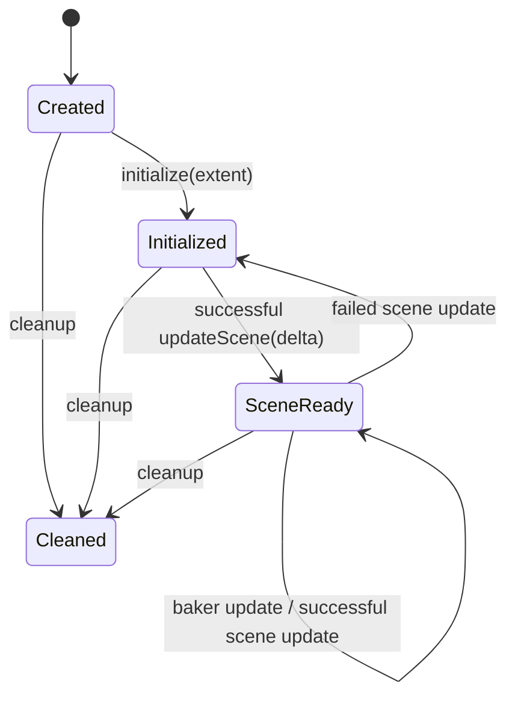

# Execution contexts and GPU lifetime

## Common ownership

`BakerContext` stores borrowed `Engine*` and root `Node*` and derives from
`enable_shared_from_this`. Its protected constructor requires non-null pointers
and engine ray-tracing support. Factories need shared context ownership because
each baker retains a shared context. `LightmapBaker` also retains its target node.
The engine must outlive these objects and the deferred release of their resources.

This division lets multiple targets share scene acceleration, environment and
lighting pipelines while retaining independent atlas buffers and histories.
`LightmapBakeExecutor` supplies the same projection/lighting/composition sequence
to both modes; contexts decide when scene data is prepared and who submits work.

Sources: [BakerContext](../../../lib/src/bg2e/render/BakerContext.cpp),
[LightmapBaker](../../../lib/src/bg2e/render/LightmapBaker.cpp).

## IntegratedBakerContext and IntegratedLightmapBaker

The application owns scene lifecycle and normal frame submission. After component
updates, `prepareFrame(cmd, frameResources)` verifies the exact current frame
resource object and its command buffer. It captures scene bindings, resets only
that slot's bake descriptors, creates/rebuilds a slot-owned `RayTracingScene`,
and records its TLAS. The render loop has already waited for that slot's fence;
other slot TLASes may still be in flight and are not recycled.

The private `PreparedFrame` records validity, engine frame number, slot and
command handle. `requirePreparedFrame()` matches all of them before allowing
an update. Preparing a context twice in one engine frame is rejected.
`IntegratedLightmapBaker` adds its own last-updated-frame guard: each target gets
one sample per engine frame, including after resetting accumulation in that frame.
A successful recording calls `markResultImage()` and increments progress; it does
not wait or submit. CPU readback must wait until the enclosing loop has submitted
and advanced the engine frame.

```cpp
// Adapted from the two editor AppDelegate::render() implementations.
context->prepareFrame(cmd, frameResources);
for (auto& job : jobs) {
    if (job.baker->completedFrames() < job.baker->settings().accumulationFrames)
        job.baker->update(cmd, frameResources);
}
// Final CPU readback is performed in a later update callback.
```

Sources: [IntegratedBakerContext](../../../lib/src/bg2e/render/IntegratedBakerContext.cpp),
[Composer delegate](../../../apps/bg2e_composer/src/AppDelegate.cpp),
[model editor delegate](../../../apps/model_edit/src/AppDelegate.cpp).

`SceneBindingSnapshot` stores forward-light uniforms plus environment path/hash.
With an attached `Scene`, it uses scene caches; otherwise it traverses enabled
nodes for lights/environment. Captured lights are capped before GI filtering.
The actual integrated IBL image/sampler comes from the borrowed
`EnvironmentResources*` supplied by `setEnvironmentResources()`, rather than
from loading the snapshot path. RTGI refuses a missing image/sampler.

The context owns per-slot bake descriptor allocators independently of the
normal frame allocator. It owns shared RT material/light bindings, AO/GI UV
pipelines and composition. Descriptors created for bake passes use those allocators,
while execution frame resources carry transient buffers/cleanup.

Baker destruction moves target images, UV surface and accumulator into
`Engine::deferredExec()`. Context destruction likewise retains TLASes, allocators,
bindings and pipelines through deferred cleanup. Cancellation may discard CPU
jobs immediately without invalidating resources referenced by submitted frames.
This relies on the engine remaining alive and flushing deferred cleanup.

## StandaloneBakerContext and StandaloneLightmapBaker

Standalone owns a shared `Scene`, one private `FrameResources`, a single TLAS
and a private `BakeResources` aggregate. The aggregate owns bake descriptors,
RT material/light bindings, AO/GI/composition passes and environment resources.
This is direct production-engine execution, not the `OffscreenApplication`
delegate path. No camera or window is needed because UV2 determines rasterization.



`initialize()` allocates resources and builds initial IBL. If there is no
usable environment image, a procedural `SkyDomeTextureGenerator(2048,1024,4)`
is loaded with mipmaps disabled. Environment ownership is retained through
engine cleanup because environment callbacks capture their owner.

`updateScene(delta)` explicitly prepares a new generation:

1. Validate state, fixed root, finite nonnegative delta and absence of an active sample.
2. Wait for device idle, clear bake descriptors and discard the prior TLAS.
3. Advance generation and reset/rebind every live baker tracked by weak pointer.
4. Run one initial `willResize`/viewport resize visitor/`didResize` sequence.
5. Run `willUpdate`, `UpdateVisitor`, light/environment cache refresh and `didUpdate`.
6. Refresh the environment resource if its path/hash changed; capture lights.
7. Record environment update and full-scene TLAS, submit and wait; enter SceneReady.

The context avoids `Scene::updateAll()` because it unconditionally requires a
main camera. It updates camera caches only when a camera exists. Lifecycle
`didUpdate`/`didResize` hooks also run when the enclosed operation throws.
A failed preparation leaves Initialized with no usable prepared TLAS.
Replacing the Scene root violates the fixed-root contract; construct a new context.

A standalone baker stores its scene generation. Its `update()` verifies current
state/generation, rejects concurrent updates, waits/reset the private frame,
records the common executor at slot zero, submits with a fence and waits. Only
a successful submission/wait marks progress and advances `Engine::currentFrame()`.
It then flushes transient cleanup and descriptors. Queue/fence failures are
reported and the fence is recreated signaled for recovery paths. No component
update or TLAS rebuild occurs in a baker sample.

Scene generations prevent accumulation over obsolete preparation, and the weak
registry avoids context/baker ownership cycles. After `updateScene()` resets a
live baker, it can accumulate again against the new generation. These guards
are lifecycle checks, not a thread-safe concurrent execution service.
`cleanup()` waits and releases execution resources, is idempotent and final,
and is forbidden during active sample execution.

Sources: [standalone declarations](../../../lib/include/bg2e/render/StandaloneBakerContext.hpp),
[standalone execution](../../../lib/src/bg2e/render/StandaloneBakerContext.cpp).
See [batch preparation](standalone_scene_and_batch.md).
