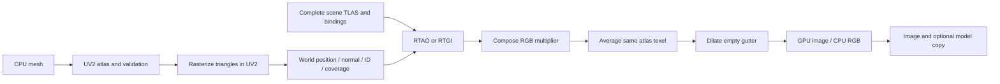

# Lightmap architecture

This family documents the production render implementation. The experimental
[integrated draw/bake tutorial](../../tutorials/draw/12_lightmaps.md) and
[bake reference](../../api/bake/index.md) describe the separate delivered path.

Lightmap baking evaluates illumination at surface points addressed by a UV2
atlas. It uses the production Vulkan `bg2e::render` framework. The UV atlas is
one image per target Drawable, including all of its submeshes; other scene
geometry contributes to ray tracing but receives its own atlas only if selected
as another target.

This documentation follows executable C++ and GLSL. The projection, storage,
resource lifetime and integration contracts below describe the current code.
RTAO/RTGI are described as lighting backends; detailed lighting algorithms belong
to the rendering pipeline documentation.

## Reading guide

| Document | Responsibility and types |
|---|---|
| [UV atlas construction and validation](uv_atlas.md) | `GenerateUv2AtlasModifier`, `Uv2AtlasOptions`, `Uv2AtlasResult`, `UvAtlasValidator`, `UvAtlasValidation`, `UvAtlasError`. |
| [Atlas surface projection](uv_surface_projection.md) | `UvSurfacePass`, `Diagnostic`, depthless `GBufferManager::Configuration`; UV triangles to world-space texels. |
| [Lighting pass architecture](lighting_passes.md) | `LightmapBakeExecutor`, `LightmapCompositionPass`, UV paths in `RTAmbientOcclusion` and `RTGlobalIllumination`; shared scene bindings. |
| [Accumulation, dilation and readback](accumulation.md) | `LightmapBaker`, `LightmapSettings`, `LightmapPixels`, `UvTemporalAccumulator`; stable atlas history. |
| [Execution contexts](contexts.md) | `BakerContext`, `IntegratedBakerContext`, `IntegratedLightmapBaker`, `StandaloneBakerContext`, `StandaloneLightmapBaker`, private snapshots/resources. |
| [Standalone assembly and batch](standalone_scene_and_batch.md) | `StandaloneBakeSceneAssembler`, its target/assembly records, `StandaloneBakeBatch` and callbacks. |
| [UV preview and editor integration](preview_and_editors.md) | `UvMapPreviewRenderer`, `UvMapPreview`, `Uv2SafeReload`, `Uv2RegenerationResult`, `ModelLightmapWindow`, `SceneLightmapWindow` and delegate bake jobs. |
| [Output and material integration](output_and_materials.md) | `LightmapOutputWriter`, `ImageFormat`, file naming/conversion; pending dedicated RGB material channel. |

The baker stores RGB multipliers, not a shaded beauty image. RTAO yields scalar
visibility replicated into RGB. RTGI yields a colored factor normalized against
environment irradiance. The material model still exposes the existing AO texture
and selected scalar AO channel; a dedicated RGB illumination channel remains
future work. Current deferred shaders contain an RGB path reusing the AO texture;
that transitional path is described explicitly in [material integration](output_and_materials.md).

Public signatures and validation rules are in the [render API](../../api/render/reference.md),
[geometry API](../../api/geo/reference.md), and [CLI guide](../../apps/lightmap_generator/index.md).

For the separate draw/bake data flow, raw-sample versus composed-output ordering,
explicit indirect modes and precision boundaries, read
[integrated draw lightmaps](../draw_integrated_lightmaps.md). The production
diagram and scalar-AO export discussion above describe render, not draw.
