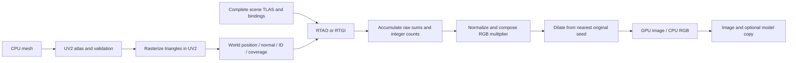

# Lightmap architecture

This family describes production bake components over GPU primitives. An atlas
addresses one target Drawable, including its submeshes; surrounding scene geometry
contributes lighting. Vulkan and Metal use explicit paired shader implementations.
Start with [the integrated tutorial](../../tutorials/draw/12_lightmaps.md) or
[standalone tutorial](../../tutorials/draw/standalone_lightmaps.md).

## Reading guide

| Document | Responsibility and types |
|---|---|
| [UV atlas construction and validation](uv_atlas.md) | `GenerateUv2AtlasModifier`, `Uv2AtlasOptions`, `Uv2AtlasResult`, `UvAtlasValidator`, `UvAtlasValidation`, `UvAtlasError`. |
| [Atlas surface projection](uv_surface_projection.md) | `UvSurfacePass`, `UvSurfaceDiagnostic`, depthless surface contracts; UV triangles to world-space texels. |
| [Lighting pass architecture](lighting_passes.md) | `LightmapBakeExecutor`, `LightmapCompositionPass`, UV paths in `RTAmbientOcclusion` and `RTGlobalIllumination`; shared scene bindings. |
| [Accumulation, dilation and readback](accumulation.md) | `LightmapBaker`, `LightmapSettings`, `LightmapPixels`, `UvTemporalAccumulator`; stable atlas history. |
| [Execution contexts](contexts.md) | `BakerContext`, `IntegratedBakerContext`, `IntegratedLightmapBaker`, `StandaloneBakerContext`, `StandaloneLightmapBaker`, private snapshots/resources. |
| [Standalone assembly and batch](standalone_scene_and_batch.md) | `StandaloneBakeSceneAssembler`, its target/assembly records, `StandaloneBakeBatch` and callbacks. |
| [UV preview and editor integration](preview_and_editors.md) | `UvMapPreviewRenderer`, `BakeLightmapPreview`, `Uv2SafeReload`, `Uv2RegenerationResult`, `ModelLightmapWindow`, `SceneLightmapWindow` and delegate bake jobs. |
| [Output and material integration](output_and_materials.md) | `bake::LightmapOutputWriter`, `ImageFormat` and file/material limits; RGB indirect contract linked below. |

The baker stores RGB indirect multipliers, not a shaded beauty image. RTAO yields
visibility replicated into RGB. RTGI yields a channelwise factor normalized
against environment irradiance; zero-reference channels produce zero. Raw sample
sums/counts precede composition and nearest-original-seed dilation.

The existing AO texture slot has explicit AmbientOcclusion, BakedAmbientOcclusion
and BakedGlobalIllumination modes. Scalar AO and an RGB baked map do not occupy
separate slots. Metadata alone does not materialize pixels: complete DB saves
export actual native sidecars, and standalone batches publish their final manifest
last. See [material/output integration](output_and_materials.md).

Public signatures and validation rules are in the [draw API](../../api/draw/reference.md),
[bake API](../../api/bake/index.md), [geometry API](../../api/geo/reference.md), and
[CLI guide](../../apps/draw_lightmap_generator.md). The diagram describes the
current draw/bake data flow. See [integrated ownership and precision](../draw_integrated_lightmaps.md)
for exact sample/result semantics and interactive display limits.

The delivered [standalone draw/bake architecture](../draw_standalone_lightmaps.md)
now covers private assembly, UV2, exact completed samples and protected complete
manifest publication. [CLI and deployment](../../apps/draw_lightmap_generator.md)
use the context and batch contracts described in this family.
