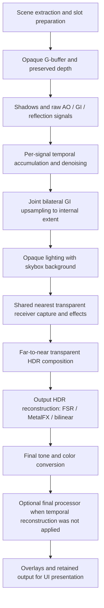

# Deferred rendering model

`bg2e::draw::RendererDeferred` renders a scene through the Vulkan or Metal backend.
Include `<bg2e/draw/all.hpp>`. The graph uses single-sample images: forward rendering
and multisample anti-aliasing (MSAA) are not selectable modes of this renderer.
This page explains the data flow; [the API reference](api/draw/RendererDeferred.md)
describes lifecycle and extension contracts.

## What deferred rendering stores

Instead of evaluating every light while drawing each triangle, the first raster
pass writes visible surface attributes into a **G-buffer**: a set of images holding
material and normal data, alongside depth. Later passes reconstruct the surface
position and evaluate lighting from these images. Depth is the camera-space
visibility result, encoded in the engine's non-reversed zero-to-one depth convention;
it is not itself a distance in world units.

A **render target** is an image written by a GPU pass. A **pass** records raster or
compute commands using previous targets as inputs. The renderer establishes image
layouts and dependencies between those commands. Recording commands does not mean
the GPU has finished executing them.

## Three resolution domains

Keep these sizes separate when reasoning about cost and image quality:

| Domain | Contents | Controlled by |
|--------|----------|---------------|
| Output | Reconstructed HDR image, final color and overlays | Application/output target |
| Internal | G-buffer, receiver depth and HDR lighting/composition | Upscale method/mode and resolution policy |
| Effect | Raw AO, GI and reflection estimates, with their own histories/filtering | Each effect's quality/output-extent policy |

For example, a 1920×1080 output in Quality mode has a 1152×648 internal image.
Medium GI uses half of that receiver extent in each dimension: 576×324.
GI is first reconstructed to the internal image using surface guides. Only after
lighting and transparency does FSR, MetalFX or bilinear resampling reconstruct
the complete image to 1920×1080. Reducing both dimensions to 60% processes roughly
36% as many internal pixels; acceleration structures, geometry, output passes and
other fixed costs do not shrink by that same factor.

## Rendering sequence

Optional stages run only when their graph, requested settings and native support
permit them. The graph records the shared tracing scene build before effect
consumers. Skybox color supplies the background; preserved opaque depth keeps
opaque visibility separate from transparent receiver scratch.

## Effect accumulation and guided GI reconstruction

Ray-traced effects usually use a small number of samples per pixel and contain
noise. `TemporalAccumulator` combines compatible samples from earlier scene
recordings. `DenoiseFilter` then filters spatial neighbors while respecting surface
guides. These are engine effect histories, separate from the history inside an
FSR or MetalFX context. Denoised images do not replace the accumulator's history.

Low-resolution GI cannot safely use ordinary bilinear interpolation across object
boundaries: a bright wall sample could leak onto a foreground object. The renderer
therefore has a **joint bilateral upsampling** stage. “Joint” means it filters one
signal (GI radiance) using other images (full internal-resolution normals and
depth). “Bilateral” means weights depend on both pixel separation and surface
similarity. It runs after GI temporal accumulation/denoising and before lighting,
not on the final scene color.

For each internal pixel, the compute shader examines a 4×4 low-resolution
neighborhood, reconstructs the corresponding receiver positions and rejects
samples on incompatible planes or normals. It blends accepted radiance with
spatial/surface weights. A valid black estimate remains valid; no compatible
estimate produces zero radiance with zero validity, allowing the lighting path's
ordinary fallback. This reduces cross-surface mixing but cannot recover geometry
or illumination never sampled at low resolution.

This private stage is enabled only for the exact built-in GBuffer and RTGI types,
when the resolved GI signal is smaller than the internal extent and its owner is
retained. Custom subclasses are not assumed to share the receiver mapping. Missing
compute shaders or required formats preserve the original scaled-GI sampling and
report an initialization warning. See [GI upsampling](api/draw/GIUpsampling.md)
for formats, thresholds, transparency and resource ownership.

## Full-image reconstruction: FSR and MetalFX

Bilinear resampling uses the current HDR image alone. Temporal reconstruction also
uses earlier images, depth and motion to recover more detail from a smaller
internal image. **Jitter** shifts the camera projection by a fraction of a pixel
between scene samples; these different sample positions provide extra information.
Motion describes where the current surface was in the previous image. Reprojection
uses that motion to find history; occlusion, newly revealed surfaces and inaccurate
motion limit its usefulness and can cause trails or ghosting.

| Method | Backend | Implementation and fallback |
|--------|---------|-----------------------------|
| None | Vulkan / Metal | No temporal reconstruction; built-in method selection uses 100% internal size. Bilinear reconstruction remains the general fallback. |
| FSR | Vulkan | Optional FidelityFX FSR 3.1 upscaler integration; missing SDK, unsupported configuration or failed dispatch falls back to bilinear. No frame generation is provided by this path. |
| MetalFX | Metal | Native temporal scaler through `MetalFXBridge`; requires macOS 13+ and a supported device/configuration. Unavailable/rejected configurations fall back to bilinear. |

Methods are `UpscaleMethod::None`, `FSR` and `MetalFX`. Modes are engine presets,
not an assumption about an SDK's named quality ratios:

| Mode | Internal width and height as a fraction of output |
|------|--------------------------------------------------|
| Native | 100% |
| Quality | 60% |
| Balanced | 55% |
| Performance | 50% |
| UltraPerformance | 35% |

Each dimension is rounded down, with a minimum of one pixel. Native requests
same-size temporal reconstruction/anti-aliasing when supported; it does not
promise that every SDK/device accepts 1×. MetalFX checks supported ratios after
rounding; rejected modes keep their selected extent and use unjittered bilinear
reconstruction. `None` retains the mode selection but uses scale 1.0.

`ResolutionSettings` as a standalone object starts disabled at scale 1.0 and accepts
[0.25, 1]. However, current `RendererDeferred::initialize` enables the unified policy
and sets the scale from method/mode on Vulkan and Metal. Do not assume an injected
fixed extent or old example scale overrides this initialization. See
[settings](api/draw/Settings.md) for live changes.

Both temporal implementations consume linear HDR RGBA16F color and preserved
opaque depth. Motion is previous minus current, in unjittered internal framebuffer
pixels, with Y down. Camera/depth motion covers the complete image. Optional opaque
receiver replay supplies rigid-object vectors where a valid token exists; elsewhere
the camera estimate remains. Replay is explicit and defaults off. Transparent
refraction and moving content seen in reflections have approximate correspondence;
there is no reactive mask or independent transparent-object motion reconstruction.

FSR and MetalFX run before tone mapping. The final layer always performs the final
color conversion once. A successful jitter-requiring reconstruction skips the
optional `FinalProcessor`, including injected SMAA, for that frame. On bilinear
fallback an injected final processor may run; no SMAA is inserted automatically.
Temporal diagnostic images bypass SDK reconstruction. See
[Upscaler](api/draw/Upscaler.md) for selection, inputs, resets and native limits.

## Transparency

Transparent and solid-transparent submeshes share a stable far-to-near order based
on projected bounds centers. This is submesh sorting, not per-triangle
order-independent transparency. Intersections and complex meshes can still need
geometry splitting.

The renderer captures the nearest transparent receiver once and computes one
shared effect set for that layer. It then replays each submesh for alpha/refraction
composition against the accumulated HDR background. Surfaces behind the nearest
receiver reuse its effects; there is no independent GI/reflection solution for
every overlapping transparent object.

Preserved opaque depth stays unchanged. The original G-buffer depth is scratch,
seeded from opaque depth before receiver capture and before each composition item.
GI upsampling uses the scratch depth paired with the captured transparent normals,
so a surface in front of empty sky still has its actual position. Full-image
reconstruction instead uses preserved opaque depth. Histories have opaque domain 0
and shared transparent domain 1 per signal/view, not one domain per object.
See [the layer contract](api/draw/RendererDeferred.md#transparent-layer).

## Frame ownership and safe edits

`MainLoop` schedules work; `RenderLoop` coordinates acquisition, retained scene
color, UI and presentation. `DefaultRenderLoopDelegate` exclusively owns a renderer,
while configuration retains injected shared components. A frame slot is reusable
storage for in-flight work, not a temporal sample count. Reuse requires completion
of its previous GPU commands. GPU objects must be released before their Device.
Scene rendering can pause while UI continues presenting the retained result.

Queue arbitrary edits with `enqueueRendererUpdate`; its conservative batch opens a
resource-update synchronization scope before callbacks. CPU value and retained
resource queues have narrower contracts and may avoid that drain. Stop independent
background producers and validate document/node lifetimes as well as renderer
generation. Call `invalidateHistories()` for cuts/teleports, in-place resource edits
and other discontinuities; it resets effect and SDK histories together.
See [update synchronization](api/draw/UpdateSynchronization.md) and
[safe scene updates](safe_update_scene.md).

## Lighting availability and further reading

Defaults request GI and enabled GI/reflections; AO starts disabled. Requested
settings do not prove native capability. Inspect `usesGlobalIllumination()`,
component `available()`/`status()`, `environmentError()` and
`initializationWarnings()`. Unsupported effects preserve their request and use
the documented IBL/baked fallback. A ray query and a complete ray-tracing kernel
profile are different requirements.

- [Renderer lifecycle and injection](api/draw/Renderer.md)
- [GI](api/draw/RTGlobalIllumination.md), [AO](api/draw/RTAmbientOcclusion.md),
  [reflections](api/draw/RTReflections.md) and [shared tracing](api/draw/TracingSceneResources.md)
- [Temporal accumulation](api/draw/TemporalAccumulator.md) and [denoising](api/draw/DenoiseFilter.md)
- [Environment generation](architecture/env_generator.md) and [deferred tutorial](tutorials/draw/10_deferred_renderer.md)
- [Offscreen linear/final split](api/draw/DefaultOffscreenApplicationDelegate.md) and [lightmap baking](lightmap_baking.md)

This description is based on the current source contracts. Backend availability
and the presence of an implementation do not establish visual or performance
acceptance for every device, effect or transparent scene.
