# Deferred rendering model

`bg2e::draw::RendererDeferred` is the production scene renderer over Vulkan or
Metal. Include `<bg2e/draw/all.hpp>`. It uses single-sample surfaces and public
pipeline components; forward rendering and MSAA are not selectable modes.

## Frame and resource ownership

MainLoop owns application scheduling. RenderLoop coordinates retained scene
color, acquisition, UI and presentation. DefaultRenderLoopDelegate exclusively
owns a Renderer; its configuration retains injected shared component owners.
GPU objects and exported images must be released before their Device/Engine.
Per-slot resources are reused only after completion. Scene update cadence may
pause independently of UI presentation; frame slots are not scene sample counts.

## Rendering sequence

```mermaid
flowchart LR
    Scene --> G[G-buffer and opaque depth]
    G --> R[Raw AO / GI / reflection signals]
    R --> T[Independent temporal histories and denoise]
    T --> L[Lighting and IBL composition]
    L --> TR[Shared transparent receivers and effects]
    TR --> TC[Ordered per-submesh HDR composition]
    TC --> U[HDR reconstruction]
    U --> F[Final color and optional SMAA]
    F --> O[Overlays]
    O --> UI[Retained output and UI presentation]
```

The renderer separates output and internal extents. Resolution settings default
to disabled with scale 1.0; enabled scaling supports [0.25, 1]. Bilinear HDR
reconstruction is available without an optional SDK. FSR is optional Vulkan
integration with explicit availability/fallback. Metal SDK-specific upscalers
and DLSS are not provided. Tone mapping/color conversion occurs once after HDR
reconstruction; debug surfaces retain their documented internal resolution.

## Transparent composition

Both transparent material classes form one far-to-near submesh sequence. The
renderer captures the nearest transparent receivers once and computes one shared
set of GI/reflection and other active effect signals for that layer. It then
replays each submesh for alpha/refraction color composition against the accumulated
HDR background. Behind surfaces reuse the topmost receiver's effects.

Preserved opaque depth stays unchanged. The original G-buffer depth is reused as
scratch, seeded from opaque depth before the receiver batch and each item, to
capture actual transparent positions. This allocates no depth images or effect
histories per object; it adds depth-copy bandwidth and raster work. Temporal
histories have opaque domain 0 and transparent domain 1 per signal/view, with
resources retained independently for in-flight frames. See [the complete layer
contract](api/draw/RendererDeferred.md#transparent-layer) for sorting limitations,
custom-pass requirements and metadata ownership.

## Lighting and effects

The default configuration requests global illumination and enabled GI/reflection
passes; AO defaults disabled. Capability and shader availability determine actual
execution. A ray-query primitive and a complete RT kernel profile are separate
requirements. Inspect diagnostics rather than interpreting a requested mode as
proof of support. Public passes accept compatible shader contracts and bindings;
Vulkan and Metal stages are explicit paired source trees.

- [Renderer and injection lifecycle](api/draw/Renderer.md)
- [RendererDeferred and G-buffer contracts](api/draw/RendererDeferred.md)
- [Advanced lighting, histories and bindings](architecture/draw_advanced_lighting.md)
- [Surface inputs](api/draw/SurfaceInputs.md), [AO](api/draw/RTAmbientOcclusion.md),
  [GI](api/draw/RTGlobalIllumination.md), [reflections](api/draw/RTReflections.md)
- [Temporal histories](api/draw/TemporalAccumulator.md),
  [denoise](api/draw/DenoiseFilter.md), [SMAA](api/draw/SMAAProcessor.md)
- [Environment generation](architecture/env_generator.md)
- [Optimization and profiling](architecture/production_performance.md)

Use [the deferred tutorial](tutorials/draw/10_deferred_renderer.md) for an actual
scene, live settings and custom component wiring. Camera output and UV lightmap
baking have different accumulation/output contracts; see [lightmaps](lightmap_baking.md).
