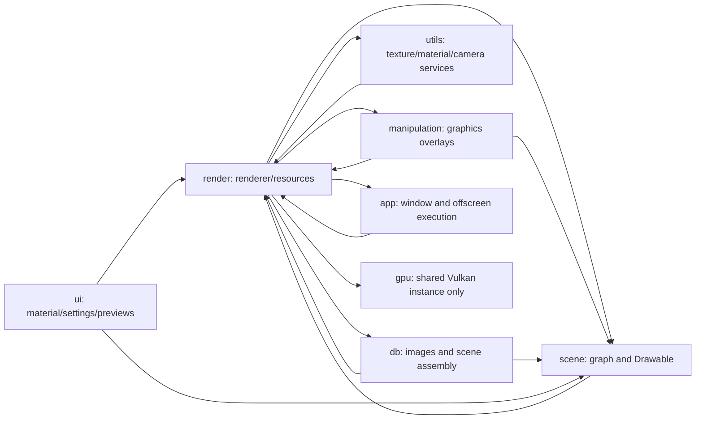

# Dependency map and affected namespaces

[Overview](index.md) · [Scene boundary](03-scene-boundary.md) · [Source evidence](13-source-evidence.md)

## 1. How to read this map

**Observed** edges below come from direct includes, public parameter/member types, and checked implementation paths. An include edge is not necessarily an ownership edge; a forward declaration is not dependency elimination; and an umbrella include can hide hundreds of transitive dependencies. Counts describe the reviewed snapshot, not linked binary dependencies or all possible template instantiations.

The production graph has cycles rather than a clean layered order:

This diagram groups namespaces. Some edges exist only in implementation or a specialized helper. It is not a claim that every class in a namespace depends on every other namespace shown.

## 2. Outgoing render dependencies

The scan of direct `bg2e/...` includes finds the following numbers of files containing each outgoing edge:

| Dependency namespace | Production header files | Production implementation/private files | Main reason |
|---|---:|---:|---|
| `scene` | 11 | 15 | Renderer ownership/traversal, Drawable queues, RT extraction, baking, analysis. |
| `base` | 13 | 23 | Materials, textures, lights, platform paths, logging. |
| `geo` | 7 | 5 | CPU mesh layouts and primitives. |
| `math` | 7 | 2 | Matrices, camera and geometry calculations. |
| `app` | 2 | 1 | Preferences, offscreen application/delegate, application orchestration. |
| `manipulation` | 2 | 0 | Gizmo/selection renderer ownership in both concrete renderers. |
| `db` | 1 | 3 | Texture loading and standalone scene/batch assembly. |
| `utils` | 0 | 3 | Texture cache and scene/material/camera helpers. |
| `gpu` | 1 | 1 | Production engine's `gpu::vk::Instance` wrapper. |
| `json` | 0 | 1 | Batch/configuration handling. |

There can be multiple edges per file; do not add columns to estimate unique file counts. `common.hpp` is excluded from this module classification.

**Proposed.** `draw` may consume `scene` data, `base`, `geo`, `math`, and `gpu`. Imports and preferences should enter through application-facing services. `gpu` must not acquire scene, material-resource, renderer, selection, or DB responsibilities to resolve these cycles.

## 3. Incoming consumers

| Consumer | Production dependence | Migration consequence |
|---|---|---|
| `scene` | `Drawable`/`RenderMesh`, Vulkan visitors and bindings; `render::Engine` in deserialization throughout component families. | Requires a geometry/resource boundary and new load context; moving only bindings is insufficient. |
| `db` | `loadDrawableBg2`, `loadDrawableObj`, glTF/scene loading and output types. | Split CPU parsing from GPU upload. Preserve old overloads as production adapters. |
| `manipulation` | SelectionManager owns Vulkan picking resources; GizmoComponent builds production Drawables; overlays own native pipelines. | Separate selection/input state from graphics passes and gizmo resource cache. |
| `ui` | MaterialEditor, TextureWidgets, RenderSettingsWindow, UvMapPreview and production UserInterface overloads. | Add neutral settings/resource views and private backend texture registration. |
| `app` | Production GraphicsExecution, Application render delegate, OffscreenApplication and GPU selection dialog. | Window selection seam exists; headless selection still needs its own seam. |
| `utils` | TextureCache returns production textures; MaterialModifier manipulates production material resources; SceneCameraUtils uses ViewpointAnalyzer. | Keep reusable CPU policy neutral; put GPU caches and analysis execution in `draw`. |
| Applications | Model editor, composer and lightmap generator assume production scene/material/settings/baker objects. | Migration involves import, editing, loading, preferences, previews, and tools, not only delegate replacement. |
| Examples | Traditional examples use production resources and `bg2e/all.hpp`; experimental examples construct GPU resources manually. | Retain production regression surfaces; add feature-level experimental examples. |

The [generated evidence appendix](13-source-evidence.md) names each file with direct production includes or qualified references. In the scoped engine scan, 45 public headers and 45 implementation/private files outside `render` are flagged. Those counts include the top-level umbrella header and textual references; they are not semantic proof that every flagged method executes rendering.

## 4. Four concrete cycles

### 4.1 Scene rendering and GPU-backed Drawable

`render::Renderer` owns a `scene::Scene`, queue and queue visitor. `scene::RenderQueueVisitor` consumes `render::RenderQueue`. That queue holds a production Vulkan mesh and production material. `scene::Drawable` supplies those resources and exposes Vulkan draw callbacks. Scene and rendering therefore depend on each other at both declaration and runtime levels.

An alias from `scene::Drawable` to a `draw` type would move the cycle, not remove it. A better boundary is scene geometry/attributes → extracted draw items → draw GPU material/bindings. The accepted narrow geometry/buffer relationship in Drawable can remain.

### 4.2 Texture loading and global caching

`render::MaterialBase` uses `utils::TextureCache`, which returns `render::Texture` and receives a `render::Engine`. Rendering resource loading thus depends on a higher utility that itself owns production rendering resources. The cache key currently includes path, filtering, mipmap/address/LOD settings and color type, but no device identity.

An experimental texture cache belongs with `draw` resource management and must be device-scoped. CPU decoding can stay in `db`; sampler semantics stay in neutral texture descriptions. Do not share a GPU cache entry across production and experimental devices merely because the filename matches.

### 4.3 Graphics overlays and manipulation

`RendererDeferred` owns `manipulation::GizmoAndSelectionRenderer`. The latter owns production engine/pipeline state and traverses scene Drawables. `GizmoComponent` itself derives from `DrawableComponent` and constructs production GPU geometry. Separating the graph visitor from rendering commands is not enough unless resource creation moves too.

Selection state and transform manipulation belong in `manipulation`. Picking and overlay graphics/resources belong in `draw`. An application adapter connects them. This makes headless rendering and future non-editor renderers independent of editor state.

### 4.4 Loading and component construction

`db::loadScene` and component factory creators pass a `render::Engine` into `Node`, `Component` and derived deserialization methods. Even camera, light, transform and controller components therefore carry a production execution dependency that many do not use directly.

Replace this with CPU-first loading plus optional upload/resolution services. Retaining legacy signatures as wrappers is feasible, but the factory registry must understand the neutral path. Simply overloading a top-level loader for `draw::Engine` will not fix a registry whose creator function type still mandates `render::Engine&`.

## 5. Public API versus private implementation

Several cleanups can reduce includes without changing behavior, such as replacing an unnecessary engine include in a visitor with a neutral extent value. That is helpful, but insufficient for APIs containing native types or production objects.

| Current exposure | Why a forward declaration is insufficient | Target treatment |
|---|---|---|
| `VkCommandBuffer`, `VkDescriptorSet`, `VkPipelineLayout` in Drawable and DrawVisitor | Native drawing contract remains even if header includes disappear. | Draw recording in `draw`; old functions in legacy adapter. |
| `render::Engine&` in Component::deserialize | Every override/factory still requires production engine identity. | Neutral context with production compatibility wrapper. |
| `render::MaterialBase*` in UI material editor | Editing currently includes GPU resource update responsibility. | Edit base attributes; notify resource synchronization service. |
| `scene::RenderMesh` typedef | Names a particular production Vulkan implementation. | Geometry/buffer association through `gpu` or a neutral resource handle. |
| `render::LightmapPixels` in DB writer | Output format is tied to the generating subsystem. | Backend-neutral pixel record; retain legacy type conversion if needed. |

## 6. Target dependency rules

**Proposed rules, not new repository instructions:**

1. `gpu` knows primitive buffers, images, shaders, pipelines, synchronization, acceleration structures and surfaces. It knows no scene, render queue, renderer settings, IBL policy or selection semantics.
2. Core `scene` knows graph structure, CPU geometry/material attributes, cameras, lights, environment declarations and component lifecycle. At most, Drawable connects geometry to GPU mesh buffers through the agreed narrow contract.
3. `draw` consumes scene data through extraction and owns high-level materials, textures, IBL, bindings, draw lists, tracing material tables, passes, histories and renderers.
4. Application/DB adapters orchestrate import, upload, persistence, UI and batch processing. They may depend on `draw`; the graphics core should not require concrete editor windows or applications.
5. Any unavoidable production coupling is contained in a named compatibility layer that can be deleted with `render`. New experimental core headers should not include `render/*`.

The desired graph is not a strict namespace-level DAG if Drawable is allowed to reference `draw`. Prefer a small geometry-resource contract in `gpu` or a separate neutral header to avoid a broad reverse edge. If a `draw::DrawableGeometry` association is chosen, it must expose only geometry/buffers and must not include renderer/material/environment dependencies. [Drawable alternatives](04-drawable-alternatives.md) compares the costs.
