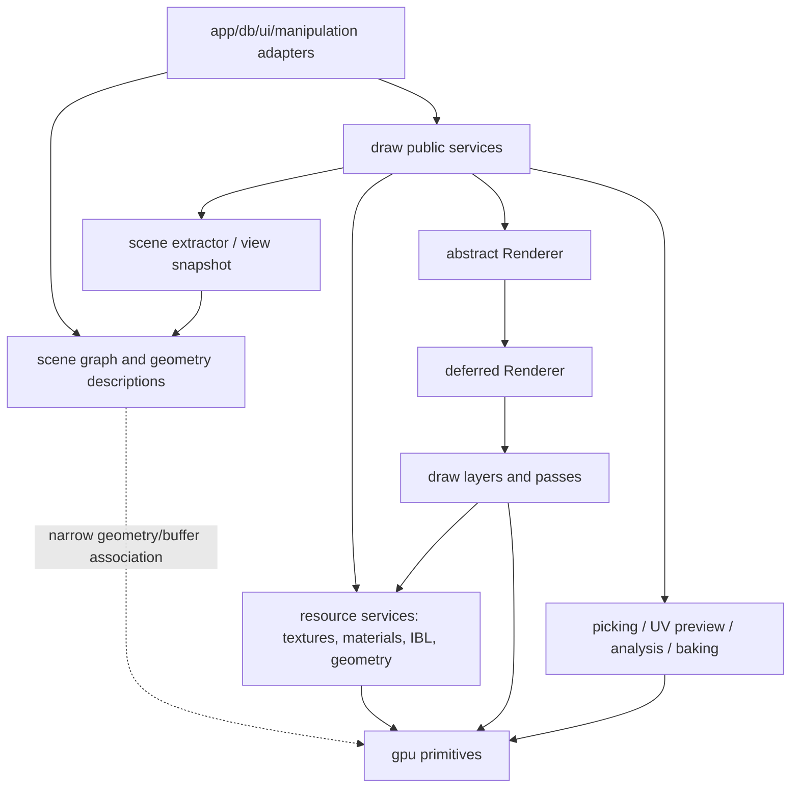

# Proposed draw architecture and engine objects

[Overview](index.md) · [GPU boundary](06-gpu-primitives-and-readiness.md) · [Pipeline](07-deferred-pipeline-and-parity.md)

## 1. Architectural objective

`draw` should be a graphics-engine framework over a low-level `gpu`, with enough reusable objects to implement renderers and graphics tools. The only proposed concrete scene renderer is deferred. Keep a virtual renderer interface so other rendering approaches can be added later without changing scene data or application execution.

The following is a target design for review, not a request to create all these names immediately.

A separate compatibility adapter may depend on production scene/render objects. It is intentionally omitted from the core graph.

## 2. Object families

| Proposed family | Purpose | Must not own |
|---|---|---|
| `Engine` / device resource context | Context lifecycle and access to device-scoped services. | One global scene, selection manager or obligatory deferred renderer. |
| `Texture`, texture/sampler cache | Realize neutral image/sampler/color descriptions. | Scene graph, preference UI, concrete renderer. |
| `MaterialResource` | GPU textures/values used by renderer bindings. | Scene nodes or graph update/input behavior. |
| Geometry realization/cache | Upload vertex/index data and maintain device/revision residency. | Light/environment/selection policy. |
| `EnvironmentResources` and generators | Cubemaps, irradiance, prefiltered maps, BRDF LUT and resource update. | Main camera/node ownership. |
| View/instance/light snapshot | Explicit immutable frame inputs. | Commands, presentation synchronization, mutable global graph references. |
| `DrawList` / extractor | Visibility, world transforms, submesh/material pairing and queue ordering. | Resource creation inside a hot traversal unless explicitly scheduled. |
| `Renderer` | Virtual renderer lifecycle and recording contract. | Vulkan public types or mandatory editor widgets. |
| `RendererDeferred` | Ordered deferred pipeline, effects and final output. | Preference storage or import parser. |
| Layers/passes | G-buffer, lighting, background, temporal, denoise, postprocessing. | Acquisition, queue submission or uncontrolled traversal. |
| Tracing scene/material service | BLAS/TLAS realizations, instance/material tables and frame-safe bindings. | Input or selection state. |
| Graphics tools | Picking, overlays, UV preview, visibility analysis and baking. | Required participation in every scene frame. |

Keep public classes only where applications need independent use. Packed shader structs and individual descriptor-binding helpers can remain private. A clean framework does not require exporting every pass implementation.

## 3. Virtual Renderer contract

Preserve these concepts from production:

- Initialization using a device/resource context and renderer configuration.
- Resize/reconfiguration when output and internal extents change.
- Update or prepare using scene/view data and elapsed **scene** time.
- Record rendering into a supplied command buffer/output target.
- Query capabilities/effective settings and retrieve useful debug/output resources.
- Deterministic resource release.

Do not retain Vulkan image-layout out-parameters, swapchain MSAA depth arguments or a centralized descriptor allocator callback. The new API should express GPU targets and resource states using primitive `gpu` contracts.

Two interface designs are plausible:

| Design | Benefit | Cost |
|---|---|---|
| Renderer consumes `scene::Scene` via a draw-owned adapter | Easier first migration and familiar delegate usage. | Renderer orchestration retains graph assumptions; multi-view/update ownership must be controlled. |
| Renderer consumes explicit `RenderSceneSnapshot` + `ViewData` | Strong isolation, testable extraction, offscreen/baking reuse and future renderer flexibility. | More up-front data/identity/revision design. |

Recommend a public convenience adapter for scenes and an internal explicit snapshot contract. This avoids requiring all applications to build snapshots manually while keeping the renderer core independent of graph mutation.

A future renderer may have different attachment/effect requirements. Therefore AO/RTGI/FSR-specific setters should not be virtual members on the base Renderer. Put deferred-specific options in grouped settings/capabilities exposed by the concrete renderer or typed feature interface.

## 4. View and frame data

Current `draw::FrameContext` supplies engine, command buffer, retained color target, extent, presentation frame number, slot and delta seconds. A deferred renderer needs additional data, but most of it belongs to a **draw view context**, not the primitive frame:

| Data | Owner |
|---|---|
| Slot and completion/acquisition context | Execution / `gpu::Surface`. |
| Output target and requested output extent | Execution/caller. |
| Internal rendering extent and effect extents | Renderer configuration. |
| Current/previous camera, jitter and clipping parameters | Per-rendered-view state. |
| Geometry/material/light/environment snapshot | Draw scene extraction/resource layer. |
| Previous object transforms | Draw instance history, if moving-object motion is added. |
| History validity and scene-render sequence | Renderer/effect history layer. |

Do not use surface frame count interchangeably with scene render count. Retained UI presentation can advance while scene rendering is paused. Temporal samples and previous matrices must advance only when the relevant view is rendered.

## 5. Resource ownership and caching

Assign resources to distinct lifetimes:

1. **Device lifetime:** default textures, immutable blue noise, reusable samplers, shader libraries, device-local upload services and caches.
2. **Asset realization lifetime:** geometry buffers, material textures and optional BLAS, keyed by identity/revisions/device generation.
3. **Scene/view lifetime:** extracted instances, environment choice, TLAS and material tables.
4. **Renderer extent lifetime:** G-buffers, intermediates, histories and final-processing resources.
5. **Frame-slot lifetime:** mutable uniform/storage buffers and resource sets that may be in flight.
6. **Command-recording lifetime:** borrowed FrameContext, temporary projection overrides and pass inputs.

Use `gpu::FrameResourceRing` where it fits individual DeviceResource types. A high-level bundle containing multiple images/sets does not naturally derive from DeviceResource; `draw` can own a vector of bundles rather than extending GPU with renderer-aware containers.

`gpu::CleanupManager::defer` captures outstanding submitted work; it does not cover commands recorded but not submitted. Detach retired resources from future draw lists/recording before deferring destruction, and keep them alive through submission. Use global device idle for coordinated resize/shutdown where already required; do not add it to ordinary per-frame resource updates.

## 6. Layers and pass contracts

Keep render layers as compositional objects, but make their dependencies explicit. A layer might take previous-layer color, appropriate depth, view/light/environment inputs and a draw list, then produce an output color/depth/effect resource bundle.

`GBuffer` is a high-level semantic resource owner. `GBufferPass` records geometry. `LightingPass` consumes G-buffer/IBL/lights and optional traced inputs. `TransparentLayer` preserves production ordering and opaque-depth reuse. Temporal and denoise passes consume typed signals rather than reaching into a main renderer.

A full render graph could later manage dependencies and memory aliasing. It is **optional**, not a prerequisite for parity. An explicit ordered pass schedule with declared inputs/outputs is enough initially. Avoid combining graph construction, resource caching and scene extraction into one large new Engine.

## 7. Settings and capability negotiation

Separate requested settings from effective implementation:

- Requested indirect mode, AO/GI/reflection quality, shadow settings, final-output mode and scale.
- Device/backend primitive capabilities.
- Renderer feature availability, including shader/SDK/resource creation requirements.
- Effective settings and fallback reason.

This prevents a temporary FSR failure or unsupported hardware from rewriting the user's stored preference. Configuration structs should avoid UI labels and dynamic option indices. UI adapters create labels/options and persistence adapters save stable identifiers with versioned conversion from current preferences.

The existing light definitions already carry shadow size/sample and reflection participation semantics. Keep those in neutral light data; the renderer chooses how to implement them.

## 8. Optional services and headless suitability

A renderer should work with no UI/selection/input and with no window. Picking/overlays are independently requested tools. Baking can reuse tracing/environment/material services without instantiating a camera viewport renderer. UV preview and viewpoint analysis should be standalone clients of `draw` resources and primitive commands.

Default delegates can orchestrate scene update, extraction, renderer invocation and optional overlays. Application adapters select production or experimental execution. This follows the existing execution seam instead of making Engine depend on application-specific delegates.

## 9. Native SDK interoperation

FSR currently requires Vulkan handles. Keep an optional private `draw` Vulkan interop module that unwraps `gpu::vk` objects and validates device/backend identity. A narrow backend-native-access facility in `gpu` may be appropriate if needed by multiple SDKs, but `gpu` should not own FidelityFX policy or FSR histories.

Commands recorded outside the normal GPU API may change layouts or bindings. The adapter must reconcile state tracking on entry/exit and obey submission/lifetime ownership. This is more than replacing an image pointer cast.

## 10. Target cleanliness criteria

Core experimental headers should not expose Vulkan or ImGui types; `gpu` backend headers remain native by design. Scene retains only the agreed narrow geometry contract. `draw` contains no forward scene renderer, but keeps virtual extensibility and specialized cubemap/preview rendering services. Compatibility code is named and isolated, and eventual removal of `render` should require deleting adapters rather than rewriting experimental core classes.
