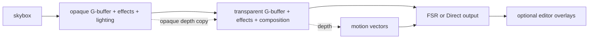

# Deferred pipeline, render layers, and parity checklist

[Overview](index.md) · [RT](08-ray-tracing-and-fallback.md) · [Offscreen/baking](11-offscreen-and-baking.md)

## 1. Current frame pipeline

Sources: [`RendererDeferred.cpp`](../../lib/src/bg2e/render/RendererDeferred.cpp), [`DeferredLayer.cpp`](../../lib/src/bg2e/render/deferred/DeferredLayer.cpp), [`GBufferManager.cpp`](../../lib/src/bg2e/render/gbuffer/GBufferManager.cpp).

**Observed sequence:**

1. Update the scene, resolve environment changes and collect transformed lights.
2. Read camera/view/projection and obtain final processor jitter. Direct output keeps the original projection.
3. Prepare scene callbacks, update the frame's tracing scene/environment, and build the render queue.
4. Render skybox/background into the first intermediate image.
5. Render opaque G-buffer, optional indirect/reflection passes, and lighting composition over the background.
6. Copy opaque depth into the transparent layer's depth resource, render transparent and solid-transparent queues, and compose over opaque color.
7. When FSR is active, generate camera/depth-based motion vectors.
8. Process final color through FSR or Direct to the output target.
9. Render editor gizmos/selection overlays at output resolution with original, unjittered matrices and dedicated cleared depth, unless offscreen.
10. End scene callbacks and save previous camera matrices/frame sequence.

Layers are already an architectural concept. The current concrete renderer constructs a fixed three-layer chain; that is not a fully general user-configurable render graph. Preserve layer composition without implying existing arbitrary layer insertion APIs.

## 2. G-buffer contract

| Attachment | Production format | Meaning |
|---|---|---|
| 0 | RGBA8 UNORM | Linear albedo plus alpha/coverage behavior. |
| 1 | RGBA16F | World-space normal; alpha stores emission signal. |
| 2 | RGBA8 UNORM | Metalness, roughness, material AO and sheen intensity. |
| 3 | RGBA8 UNORM | Fresnel tint plus packed material flags. |
| 4 | RGBA8 UNORM | Sheen color plus refraction factor. |
| 5 | RGBA8 UNORM | Baked RGB indirect-light multiplier, neutral white when absent. |
| Depth | D32 float by default | Position reconstruction, occlusion, temporal rejection and opaque-depth reuse. |

Historic deferred documentation describes earlier four-attachment designs. Current shader outputs and manager configuration are the parity baseline. A schema change is possible, but requires simultaneous shader, binding, debug, bake and effect input changes.

The six color attachments total **28 bytes per pixel**, plus four bytes of depth. At 1920×1080 that is approximately **63.3 MiB per G-buffer set** before padding/driver overhead. Two layers across two slots give approximately 253 MiB at that internal resolution, before effects, histories, intermediates, IBL or final-processing resources. Rendering at 50% in each dimension reduces those particular buffers by approximately four times. This is a formula-based illustration of allocation magnitude, not measured device usage.

## 3. Queues and transparency

Production classifies material instances into `Opaque`, `Transparent` and `SolidTransparent`. Transparent queues are separately sorted by squared distance from camera to the translation component of world matrices. The transparent layer renders the ordinary transparent queue and then the solid-transparent queue.

The new draw list should preserve flags, ordering, submesh visibility and world-transform composition. The current sort is an object-origin heuristic, not robust polygon sorting or order-independent transparency. Those improvements are optional.

Transparent geometry uses copied opaque depth and disabled depth writes while retaining a depth test. Refraction is screen-space sampling from the previous layer's image, not traced refraction. Deferred transparency accumulates into a limited G-buffer representation, so it should not be advertised as arbitrary multilayer transparent transport.

The RT collector excludes transparent material instances from its traced scene. Transparent surfaces may still be camera-layer receivers of lighting/reflections; that does not mean transparent geometry participates as RT occluders/hit objects. Preserve this distinction or explicitly approve expanded behavior.

## 4. Complete functional matrix

| Capability | Production state | Experimental target | Main dependencies/acceptance condition |
|---|---|---|---|
| Virtual scene renderer | `Renderer` base with forward/deferred subclasses. | Virtual base; only deferred implementation. | No Vulkan public signatures; future renderer-specific settings remain separable. |
| Forward renderer | Maintained production path. | Excluded. | Existing production callers retain it during coexistence. |
| Layer composition | Skybox → opaque → transparent. | Preserve and clarify layer interfaces. | Explicit inputs/output/depth lifetime and extent. |
| PBR direct lighting | Deferred light buffer and material channels. | Preserve. | Neutral light snapshots, shader packing and current light limits. |
| IBL/skybox | Environment conversion, irradiance, prefilter, LUT, blur and switching. | Preserve as draw resources/passes. | Both raster baseline and RT use these resources. |
| Material flags and textures | Six texture families, channel/UV/scale semantics, alpha cutoff, unlit, sheen/Fresnel/refraction, baked AO metadata. | Preserve. | CPU definition and GPU realization split; shader parity checked. |
| Transparent/solid-transparent | Queue flags, sorting and opaque-depth reuse. | Preserve current behavior. | MRT and depth-write/load/store/copy primitives. |
| RTAO | Ray-query compute plus scalar history and bilateral denoise. | Optional capability; preserve settings/results when supported. | TLAS/cutout tables, formats, neutral fallback. |
| RTGI | Trace pipeline, materials/lights/IBL, HDR history/denoise. | Optional capability; preserve modes/quality. | Cutouts, scene table, shader backend equivalence. |
| RT reflections | Trace pipeline, roughness/quality, material hit lighting, confidence/mask and temporal history. | Optional capability. | Display-relative effect resolution, fallback and alpha semantics. |
| RT soft shadows | Ray queries during direct composite and secondary lighting. | Optional capability. | Per-light source size/samples, masks and alpha-cutout tests. |
| Temporal accumulation | AO, GI and reflection histories. | Preserve as independent history instances. | Correct view/layer/signal identity and scene-frame sequencing. |
| Denoise | Scalar/HDR bilateral passes. | Preserve. | Signal formats and depth/normal rejection. |
| Blue noise | Shared sampling resource. | Preserve. | Device-scoped upload and consistent sampling coordinates. |
| FSR upscaling/native AA | FSR3 upscaler on non-Apple Vulkan path. | Optional Vulkan-backed final processor. | SDK interop, input states, jitter/vectors and context lifetime. |
| Direct output | Fallback/native rendering at 100%. | Required baseline. | No RT or FSR requirement. |
| SMAA | Implemented processor/postprocessor, outside current mode enum. | Preserve usable facility. | Additional formats/lookup images/shaders; integration decision explicit. |
| Render scale | Internal versus output extent; setter clamps 25–150%. | Preserve useful scale behavior. | FSR mode ratios and Direct policy resolved separately. |
| Color correction | Brightness/contrast/exposure on composition/skybox. | Preserve. | Consistent placement/color domain and no duplicate application. |
| Debug visualization | G-buffer/AO/GI/reflection/intermediate modes. | Preserve. | Unavailable-effect modes produce defined behavior/status. |
| Selection and gizmos | Picking, highlight and editor overlays. | Draw graphics tools with manipulation state external. | IDs/readback, unjittered output-resolution overlay. |
| Offscreen camera rendering | Production engine/delegate/app headless path. | Draw headless execution plus same renderer. | Windowless context, completion/readback and export. |
| UV map preview | Standalone graphics tool. | Preserve. | CPU geometry plus line/fill graphics state. |
| Viewpoint analysis | Batch visibility/ID/depth rendering and CPU scoring. | Preserve graphics service. | Typed/depth readback and stable mapping. |
| Lightmap baking | Integrated and standalone RTAO/RTGI, accumulation/dilation/output. | Preserve through optional draw baking subsystem. | UV surfaces, tracing services, scene generations and float export. |
| Imports/serialization | Current engine-bound scene/drawable loading. | Neutral loading plus backend realization/adapters. | `.bg2`/OBJ/glTF, progress, metadata and schema compatibility. |
| Settings persistence | Concrete renderer preference wrapper. | Adapter over neutral settings. | Stable identifiers and old option-index conversion. |
| Scene pause/async loading | Retained scene/UI execution paths. | Preserve experimental lifecycle. | No accidental temporal advancement during presentation-only frames. |

Rows covering tools, imports and persistence are included because they are coupled consumers or production capabilities. They are not a proposal to put file parsing or editor state inside the renderer.

## 5. Internal versus output extent

`RendererDeferred` starts at 50% internal scale and FSRPerformance when available; it falls back to Direct with 100% scale. Reflections derive quality extent from **display extent**, not only internal G-buffer extent. AO/GI have their own quality scaling. Gizmos use the final target extent.

A target contract needs at least output extent, internal geometry extent and per-effect extent. Resize/scale changes can invalidate different resources: changing display size without changing internal extent still matters to reflection quality and final processing. Preserve those relationships and make them explicit in configuration.

## 6. Frame and history requirements

Production resources frequently duplicate per frame slot. Temporal effects additionally depend on previous rendered view data. New frame handling must distinguish:

- Acquired presentation image index.
- Mutable resource slot protected by completion.
- Surface generation after resize.
- Scene-render sequence.
- View/effect history generation.

These are not interchangeable. The retained draw loop can present UI without running update/render. A future renderer must request additional scene frames while temporal convergence or animation needs them, but stop at the agreed pause policy.

Reset histories on viewport/internal/effect extent changes, camera discontinuity, relevant material/geometry/light/environment changes, effect mode/quality change and backend/device generation changes. Some reset cases are improved target behavior beyond production's current implementation; they should be separately identified in the implementation plan.

## 7. Parity versus improvements

Preserving the current G-buffer/layer ordering and fallback behavior is the initial reference. Potential improvements include a render graph, HDR composition throughout, moving-object velocities, reactive masks, OIT, screen-space no-RT effects, more advanced RT transparency, clustered light culling and resource aliasing.

None should be silently added to the estimate for “all existing features.” Conversely, removing baking/SMAA/debug/preview functions from scope simply because they are not current viewport defaults would understate the requested magnitude.

## 8. Validation scenarios for later implementation

Use equivalent scenes with production/experimental renderers to inspect material channels, alpha-cutout leaves, emissive/UV1 materials, baked AO/RGB multipliers, overlapping transparent submeshes and refraction. Compare both RT-enabled and no-RT paths. Exercise each debug view, scale/output mode, pause/resume, resize and environment switch. Test offscreen output without editor services.

These are future acceptance scenarios; no rendering comparison or build was performed during this analysis.
