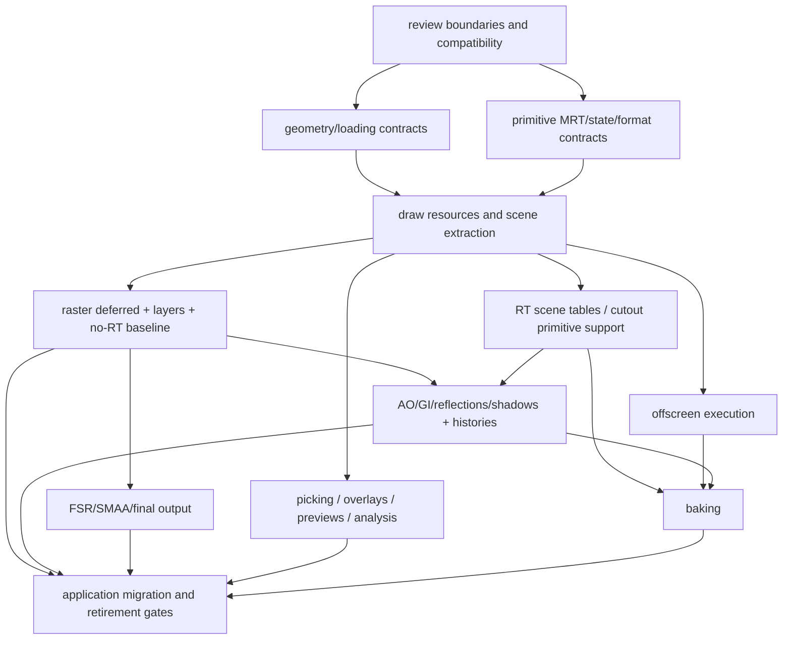

# Coexistence, migration magnitude, and decisions before implementation

[Overview](index.md) · [Drawable options](04-drawable-alternatives.md) · [Source evidence](13-source-evidence.md)

## 1. Compatibility has several meanings

The desired outcome is production and experimental APIs usable during transition, with a clean route to make production legacy and eventually delete it. That does not require every old symbol to work on every new backend.

| Compatibility level | Feasibility and cost |
|---|---|
| Both frameworks present in the repository/library | Already partially established by draw/gpu and MainLoop execution selection. Preserve additively. |
| Existing production applications keep running unchanged | Feasible by retaining production execution/resources and isolated adapters; verification still required. |
| Experimental apps use the same CPU scene/material assets | Desirable and feasible after neutral parsing/geometry contracts. |
| One scene is rendered by both frameworks with equivalent data | Feasible through independent device realizations and a coherent snapshot/revision model. |
| Every old scene/render signature remains source-compatible | Possible only with significant facade debt; native callbacks and custom subclasses limit cleanliness. |
| Binary/ABI compatibility without recompilation | Not assumed. Changing layout, virtual methods, typedefs or factory function types can break it. |
| Same GPU buffers shared across production and experimental Vulkan | Not a default: devices/allocators/queues/lifetime differ. Dedicated interop work required. |
| Same native resources shared with Metal | Not a consequence of backend abstraction. Treat resources as independent realizations. |
| Production and experimental engines run simultaneously | Separate lifecycle/device/window/context requirement; not provided merely by selectable MainLoop paths. |
| Identical images across both APIs/backends | Requires defined tolerances/reference scenes; stochastic RT and shader differences preclude assuming byte equality. |

The user prioritizes a clean experimental API over absolute compatibility. Therefore prefer a bounded facade or deliberate migration break over permanently embedding both renderers/material systems in scene.

## 2. Existing coexistence seam

[`Application`](../../lib/include/bg2e/app/Application.hpp) supports separate render/draw delegates. [`MainLoop`](../../lib/include/bg2e/app/MainLoop.hpp) selects the execution path through overload/configuration, and private RenderGraphicsExecution/DrawGraphicsExecution isolate lifecycle details. Draw validation rejects a production render delegate in the experimental path.

UI also has experimental overloads and private Vulkan/Metal backends. Preserve these seams. Application migration can select draw while production apps retain render. OffscreenApplication does not yet have the same neutral selection seam and must be assessed separately.

Draw Engine retains a backend lease but controls the initialized lifetime of a shared Instance wrapper and rejects an already initialized instance. Running multiple contexts concurrently may require explicit backend/context ownership changes. Do not promise simultaneous dual rendering until this is designed.

## 3. Compatibility layer shape

Suggested responsibilities for a named, removable compatibility family:

- Read CPU geometry/material metadata from current scene Drawables.
- Adapt production load/deserialize convenience functions to neutral CPU parsing and production upload.
- Preserve production material editor/settings entry points by translating to neutral models.
- Keep legacy native draw callbacks and scene::vk forwarding names where required.
- Convert legacy settings indices and output pixel records.

Core experimental headers should not include this family transitively. Compatibility may depend on both APIs; neither core API should depend on compatibility. A deprecated forwarding header is useful only when its semantics are honest, not when an alias hides incompatible resource ownership or native types.

## 4. Eventual legacy retirement

Define removal conditions rather than a speculative date:

1. Experimental deferred rendering meets agreed feature/backend/no-RT acceptance gates.
2. Model editor, composer and lightmap CLI no longer rely on production GPU resources or engine-bound loading.
3. Scene/material serialization can load existing assets without initializing production.
4. Selection, UI previews, settings persistence, UV tools and viewpoint analysis use neutral models/experimental services.
5. No experimental core header/source depends on `render` or the compatibility bridge.
6. Production native methods are isolated and documented as legacy; examples that remain demonstrate legacy intentionally.
7. Build/package/standalone outputs include needed experimental shader/SDK assets and have a clear production opt-out path.

Then production can be labeled legacy, and eventually removed along with forwarding/adaptation code. Deleting the facade should not require rewriting Drawable data, shader algorithms, DB formats or experimental renderer contracts.

## 5. Work-package assessment

Sizes describe relative complexity: **S** localized definitions/adapters, **M** several collaborating objects, **L** broad subsystem integration, **XL** architecture/backend work with several correctness dimensions. These are judgments, not duration or staffing estimates. Packages overlap and cannot be added as numeric estimates.

| Package | Size | Main work | Principal uncertainty |
|---|---|---|---|
| Geometry/Drawable boundary | XL | Neutral data view, narrow buffer contract, revisions, clone/import/legacy adapters. | Source compatibility versus immediate cleanliness. |
| Neutral loading/factories | L–XL | Component virtual loading, registry, `.bg2`/OBJ/glTF/scene parsing/upload, progress. | Custom components and existing convenience behavior. |
| Primitive deferred GPU support | L | MRT, attachment policies, pipeline depth/blend state, formats/limits, backend parity. | Metal depth/attachment behavior and portable capability baseline. |
| Draw texture/material/IBL services | L | Upload/mips/cache/defaults, shader binding, environment processing. | Device/revision ownership and cross-backend ABI/color conventions. |
| Renderer/layer framework and raster deferred | L | Virtual contract, extraction, draw lists, G-buffer/composition/transparency/debug. | Which parts are public versus private; exact transparency parity. |
| Tracing scene/material infrastructure | XL | BLAS/TLAS cache, instance mapping, arrays/addressing, non-opaque geometry/cutouts. | Chosen table strategy and Metal equivalent. |
| AO/GI/reflections/soft-shadow effects | XL | Shader ports, quality/settings, neutral fallbacks, histories, denoise. | Two-backend behavioral equivalence and signal semantics. |
| FSR/final processing/SMAA | L | Native SDK interop, jitter/vectors, state/lifetime, mode transitions and spatial AA. | Vulkan-only parity versus a new Metal integration. |
| Selection/overlays/UI tools | L | Picking/readback/IDs, gizmo resources, neutral editing/previews/settings. | Identity/lifetime and component migration. |
| Headless camera execution | M–L | Engine/offscreen adapter, output/readback/convergence. | Device/context ownership and output format contract. |
| Full lightmap baking | XL | UV targets, shared tracing resources, context state, accumulation/dilation/export/batch. | Float readback, scene locking/generation and target metadata. |
| Viewpoint/UV-preview utilities | M | Specialized graphics passes and neutral scoring/output adapters. | Typed/depth readback and reuse with picking. |
| Production compatibility and retirement | L | Facades, application transitions, preference/schema compatibility, dependency cleanup. | Whether ABI support or concurrent devices are required. |
| Shader packaging and distribution | M | Library/example shader paths, standalone output and optional SDK packaging. | Required platforms and explicit build-system authorization. |

The count of existing files is large, but not every file is ported. Vulkan wrappers are replaced by GPU counterparts, forward is excluded, and high-level functionality is reorganized. Conversely, a short RendererDeferred facade can conceal most of the required work in scene, tools and GPU.

## 6. Dependency order, before a detailed plan

The following ordering expresses prerequisites, not an approved step-by-step implementation plan:

A bridge can let raster resource work begin before every importer is neutral, but it does not remove the importer work from the full objective. Primitive examples and isolated graphics tools can validate contracts earlier than a complete application migration.

## 7. Risk register

| Risk | Consequence | Suggested control |
|---|---|---|
| Scene material/engine ownership copied into draw-enabled Drawable | New scene remains coupled and legacy is hard to remove. | Narrow geometry contract; materials/bindings external. |
| G-buffer based on historical docs | Missing baked lighting and incompatible effects/debug. | Current code/shader schema as parity reference. |
| GPU expanded with render-specific objects | Low-level framework loses intended scope. | Primitive examples and ownership rules from document 06. |
| Opaque experimental BLAS used for cutout materials | Solid shadows/GI/reflections through holes. | Non-opaque geometry + query/any-hit equivalents before RT parity signoff. |
| Instance/table ordering mismatch | Wrong material/geometry sampled on hits. | Coherent snapshot, explicit mapping and capacity behavior. |
| CPU update flags consumed by one backend | Other realization remains stale. | Revision-based per-device synchronization. |
| Presentation count used as temporal history count | Pause/resume/dirty redraw corrupts history. | Separate scene-render/view generation sequence. |
| Depth store/copy policy assumed portable | Later effects reconstruct invalid positions. | Explicit primitive attachment/store/usage contract. |
| Native FSR state changes bypass GPU tracking | Incorrect transitions or resource lifetime. | Private checked interop and state reconciliation. |
| UI/pick handles survive resource replacement | Stale texture use or wrong selection. | Generation identity and completion-aware retirement. |
| Baking omitted from total scope | Viewport parity mistaken for full feature parity. | Separate visible baking acceptance gate. |
| Binary compatibility assumed | Existing applications/subclasses fail after library update. | Declare source-only versus ABI support before interface changes. |

## 8. Decisions for the user's architectural review

1. **Drawable target:** external realizations (Option B) or accepted narrow buffer association (Option C), and whether Option A is useful during transition.
2. **Compatibility guarantee:** production source stability only, ABI stability, concurrent dual contexts, or some subset.
3. **Backend release gate:** Vulkan parity first, or Vulkan and Metal raster/RT parity together. FSR Metal is additional scope unless explicitly chosen.
4. **Tracing tables:** generic descriptor/resource arrays, packed geometry/texture addressing, or a draw-private backend service.
5. **Scene loading:** CPU-first neutral factories/context, and how user component overrides migrate.
6. **Public draw surface:** which resources/tools are independent public services and which shader-binding/pass details stay private.
7. **Frame/history behavior:** animation/convergence requests, pause semantics, multiple views and camera cuts.
8. **Baking parity:** same existing integrated/standalone API semantics versus a cleaner new API with production adapters.
9. **Improvements versus parity:** whether moving-object vectors, HDR throughout, no-RT screen-space effects, OIT, larger limits or render graph are separate projects.
10. **Legacy end state:** forwarding names and deletion gates, especially for scene::vk and native Drawable methods.

No immediate answer is required to complete this analysis. These questions are provided for the deeper review requested before an implementation plan.

## 9. Verification strategy for the later plan

The repository uses examples as its main verification surface. Suggested gates are primitive MRT/state/readback examples, raster deferred material/transparency/IBL scenes on no-RT devices, cutout-aware tracing scenes, temporal pause/resize/edit scenarios, FSR mode/fallback checks, picking/preview lifetime checks, headless outputs and integrated/standalone bake generation/export checks.

Keep a production reference set running during migration. Compare images/statistics within agreed tolerances, not solely successful compilation. Track import/schema/preference compatibility separately from graphics parity. Build/package changes must be explicitly requested when implementation reaches that stage.

No build, executable, GPU capture or image comparison was run for this assessment. Documentation links, scoped inventory/counts and source claims were checked statically.
